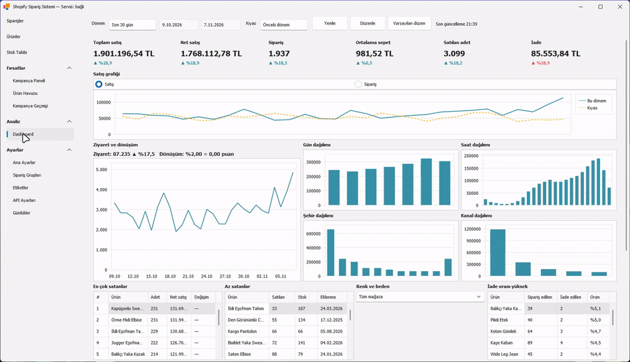
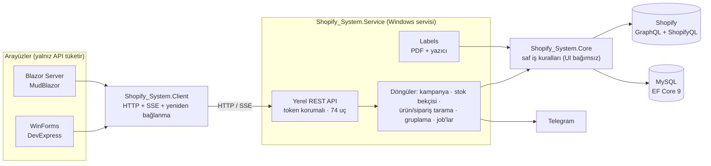
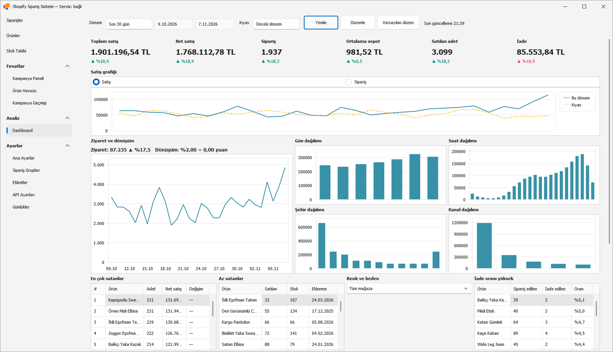
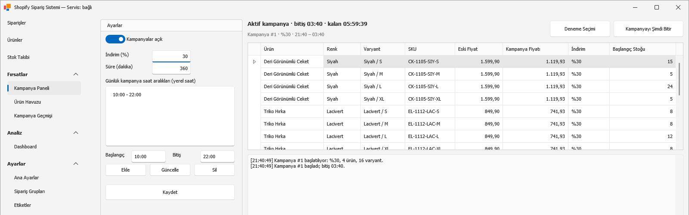
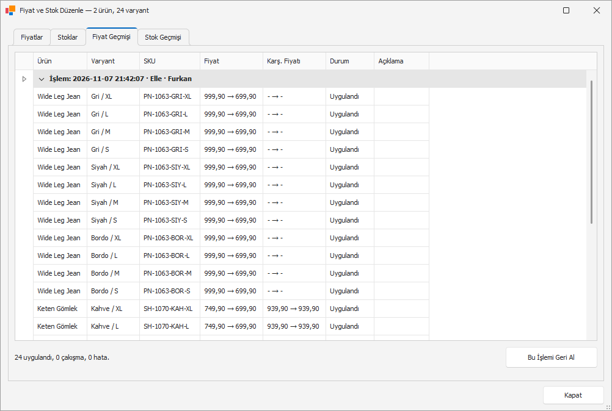
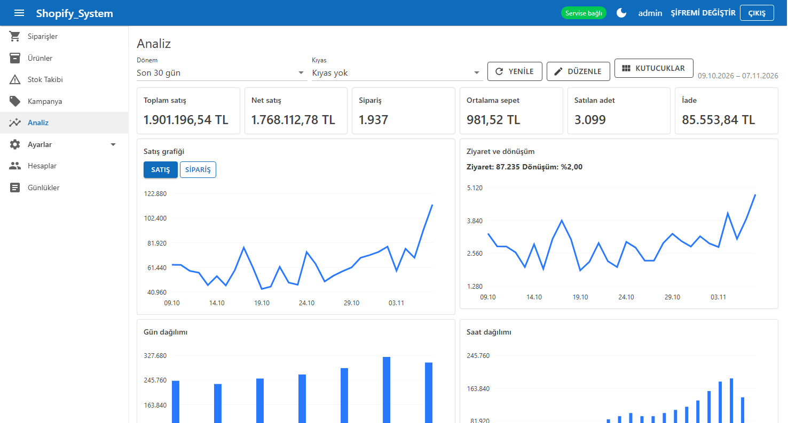

# Shopify_System — E-ticaret Operasyon Platformu

**Bir moda e-ticaret markasının günlük Shopify operasyonunu — stok, fiyat, kampanya, sipariş gruplama, barkod etiketi ve satış analitiği — tek bir servis + masaüstü + web platformunda toplayan sistem.**

-lightgrey)

> **30 saniyede:**
> - **Problem:** Mağaza operasyonu birbirinden kopuk 5+ ayrı araçla yürüyordu; her biri Shopify'a ayrı bağlanıyor, ayarları ayrı tutuyor, bilgisayar kapanınca duruyordu.
> - **Çözüm:** Tüm iş döngülerini 7/24 çalışan bir **Windows servisine** taşıdım; masaüstü (WinForms) ve web (Blazor) arayüzleri yalnızca bu servisin **token korumalı yerel REST API**'sini kullanıyor.
> - **Kanıt:** ~40.000 satır üretim kodu, **1.700+ otomatik test**, 74 belgelenmiş API ucu, mimari kuralları testlerle zorlanan 7 projelik çözüm.

  

<b>English summary</b>

Shopify_System is an operations platform for a fashion e-commerce brand. A .NET 9 Windows Service owns every background loop (flash-sale campaigns, negative-stock guard, product/order scanning, auto order grouping, barcode label generation, price/stock jobs, Telegram alerts and commands) and exposes a token-protected local REST API with Server-Sent Events. A DevExpress WinForms client and a Blazor Server (MudBlazor) web UI consume only that API. ~40k LOC production code, 1,700+ xUnit/bUnit tests, architecture rules enforced by tests. Source code is private (commercial); a live walkthrough is available on request.

---

## İçindekiler
[Problem](#problem) · [Çözüm](#çözüm) · [Özellikler](#öne-çıkan-özellikler) · [Mimari](#mimari) · [Mühendislik kararları](#mühendislik-kararları) · [Kalite](#kalite-ve-test) · [Teknolojiler](#teknoloji-yığını) · [Ekranlar](#ekran-görüntüleri) · [Rolüm](#rolüm)

## Problem

Markanın Shopify operasyonu zamanla birçok bağımsız masaüstü aracına dağılmıştı: etiket basan bir uygulama, kampanya yöneten başka bir uygulama, stok izleyen bir bot, sipariş indiren bir araç…

Bu dağınıklığın somut maliyetleri vardı:

- **Tek hata noktası:** Döngüler arayüzün içindeydi — bilgisayar kapanırsa ya da uygulama kapatılırsa kampanya fiyatları geri yüklenmiyor, eksi stok fark edilmiyordu.
- **Tekrarlanan entegrasyon:** Her araç Shopify'a kendi yöntemiyle (bazıları REST, bazıları tarayıcı otomasyonu) bağlanıyor, token'ları ayrı ayrı saklıyordu.
- **Görünürlük yok:** Satış, kampanya etkisi ve stok riski tek bir yerden izlenemiyordu.

## Çözüm

Platformu **servis-merkezli** olarak yeniden tasarladım:

1. **Shopify_System.Service** (Windows servisi) tüm uzun ömürlü işlerin sahibidir ve 7/24 çalışır.
2. Arayüzler (masaüstü ve web) **hiçbir zaman** doğrudan Shopify'a, MySQL'e veya Telegram'a bağlanmaz; yalnızca servisin yerel API'sini kullanır.
3. İş kuralları UI'dan bağımsız, saf ve test edilebilir sınıflarda (`*Planner`, `*Validator`, `*Calculator`) yaşar.

Geçiş, her biri ayrı tasarım dokümanı (spec) ile planlanan **aşamalar** halinde yapıldı: Core ayrımı → kampanya/bekçi/tarama servise → sipariş gruplama → ayarlar → fiyat/stok → Shopify okuma API'si → ShopifyQL panosu → API dış tüketim belgesi.

## Öne çıkan özellikler

| Modül | Ne yapar |
|---|---|
| **Flash kampanya (V-Fırsat)** | Uygun ürünlerden kurallara göre seçim yapar, belirli saatlerde indirimli fiyat + metafield yazar, süre dolunca orijinal fiyatı geri yükler. Mağaza temasında geri sayımlı kampanya bölümünü besler. |
| **Eksi stok bekçisi** | Negatif stoğa düşen varyantları yakalar, Telegram'dan uyarır. |
| **Fiyat & stok düzenleme** | Toplu fiyat/karşılaştırma fiyatı ve stok işlemleri; geçmiş kaydı ve **geri alma** desteği; arka plan job'ları olarak çalışır. |
| **Sipariş gruplama** | Kurallara göre siparişlere otomatik etiket ekler/kaldırır (paketleme akışını hızlandırır). |
| **Barkod etiketleri** | Siparişten etiket modeli üretir, DevExpress Reporting ile PDF çizer, Navlungo kargo PDF'lerini okur, servis yazıcısından basar. |
| **Pano (Analytics)** | ShopifyQL sorgularıyla KPI kartları, grafikler, ürün/varyant performansı, kampanya etkisi ve stok içgörüleri; dönem karşılaştırmalı. |
| **Web arayüzü** | Blazor Server + MudBlazor; kullanıcı hesapları, ürünler, siparişler, kampanyalar, stok izleme, loglar, ayarlar. |
| **Telegram** | Sağlık uyarıları ve uzaktan komutlar. |

## Mimari

| Proje | Sorumluluk |
|---|---|
| `Shopify_System.Core` (`net9.0`) | Shopify, MySQL, kampanya, stok, fiyat, analiz mantığı. WinForms/DevExpress'e **bağımlı olamaz**. |
| `Shopify_System.Service` | Windows servisi + yerel API; tüm döngülerin sahibi. |
| `Shopify_System.Labels` | Etiket çizimi, PDF birleştirme/döndürme, Navlungo PDF okuma, yazdırma. |
| `Shopify_System.Client` | WinForms ve web'in ortak tipli API istemcisi (SSE olay akışı dahil). |
| `Shopify_System` | DevExpress WinForms masaüstü arayüzü. |
| `Shopify_System.Web` | Blazor Server + MudBlazor web arayüzü (servis kendi sürecinde sunar). |
| `Shopify_System.Tests` | xUnit + bUnit test paketi. |

## Mühendislik kararları

- **Mimari kurallar testle zorlanır.** "Arayüz MySQL'e bağlanmaz", "arayüz Shopify ayarını okumaz", "web servis iç sınıflarını kullanmaz" gibi kurallar `UiDatabaseIndependenceTests`, `UiShopifyIndependenceTests`, `WebIndependenceTests` gibi testlerle kontrol edilir. Kural çiğnenirse derleme hattı kırılır.
- **API belgesi de testle zorlanır.** Her yeni uç `docs/API.md`'de belgelenmek zorunda (`ApiDocumentationTests`).
- **Gizli bilgi güvenliği.** Shopify/Telegram token'ları DPAPI ile şifrelenir, API yanıtlarında asla dönmez (yalnızca maskeli ipucu).
- **Veri kaybına karşı atomik dosya yazımı.** Ayarlar `AtomicFile` ile yazılır; okunamayan bir dosya varsayılan değerle mevcut veriyi ezmez (`LoadFailed` durumu).
- **Yalnız GraphQL.** Shopify okuma/yazma tamamen GraphQL Admin API ile; sayfalama (`GraphPager`) ve zaman aşımı/yeniden deneme (`ShopifyRequest`) merkezi.
- **Özellik bazlı klasörleme ve rol bildiren adlandırma.** `*Planner/*Validator` saf, `*Runner/*Service` yan etkili, `I*Store` Shopify, `*Repository` MySQL — kod tabanında gezinmek öngörülebilir.
- **Canlı testler yalnız geliştirme mağazasında**, `SHOPIFY_LIVE=1` bayrağıyla ve geri alma disipliniyle.

## Kalite ve test

| Metrik | Değer |
|---|---|
| Üretim kodu | ~40.000 satır C# / Razor (6 proje) |
| Test kodu | ~30.000 satır, **1.700+** `[Fact]/[Theory]` |
| Test araçları | xUnit, bUnit (Blazor bileşen testleri), coverlet |
| API | 74 belgelenmiş uç, sürümlü (`/api/v1`) |
| Dağıtım | Inno Setup kurulum paketi |

## Teknoloji yığını

| Katman | Teknolojiler |
|---|---|
| Dil / Runtime | C# 13, .NET 9 |
| Arka uç | ASP.NET Core Minimal API, Windows Service (`Microsoft.Extensions.Hosting.WindowsServices`), Server-Sent Events |
| Arayüz | DevExpress WinForms 26.1, Blazor Server, MudBlazor |
| Veri | EF Core 9 + Pomelo MySQL, migration'lar |
| Entegrasyon | ShopifySharp (GraphQL), ShopifyQL, Telegram Bot API |
| Raporlama | DevExpress Reporting, ZXing.Net (barkod/QR) |
| Gözlemlenebilirlik | Serilog |
| Güvenlik | DPAPI (makine kapsamlı), API token, ASP.NET Identity (web hesapları) |

## Ekran görüntüleri

| | |
|---|---|
|  **Pano** — KPI ve dönem karşılaştırması |  **Kampanyalar** — aktif tur, %30 indirim ve geri sayım |
|  **Fiyat/stok düzenleme** — işlem geçmişi ve tek tıkla geri alma |  **Web arayüzü** — MudBlazor ile analiz sayfası |

> Görsellerdeki tüm ürün, sipariş, müşteri ve satış bilgileri kurgusaldır. Uygulama, izole bir demo kopyasında ayrı bir veri klasörü ve demo veritabanıyla, gerçek Shopify yerine yerel bir sahte GraphQL sunucusuna bağlanarak çalıştırılmıştır; görsellerdeki fiyat değişiklikleri hiçbir mağazaya yazılmamıştır.

## Rolüm

Projenin tek geliştiricisiyim: ihtiyaç analizi, mimari tasarım, aşamalı geçiş planı, geliştirme, test ve kurulum paketinin hazırlanması.

## Kaynak kodu hakkında

Bu depo bir **vaka çalışmasıdır**. Kod, ticari bir işletmeye ait olduğu için herkese açık değildir. Mimariyi ekran paylaşımıyla göstermekten ve teknik görüşmede kod üzerinden konuşmaktan memnuniyet duyarım.

**Paylaşılabilen kısım:** [`ornek-kod/`](ornek-kod) klasöründe asıl projeden alınmış, gizli bilgi içermeyen küçük bir parça var: atomik ayar dosyası yazımı (`AtomicFile`) ve fiyat değişikliği doğrulama kuralları (`PriceValidator`). Tek başına derlenir ve birim testleriyle birlikte gelir (`dotnet test`).

📫 **İletişim:** [GitHub profilim](https://github.com/furkan-karapinar)
